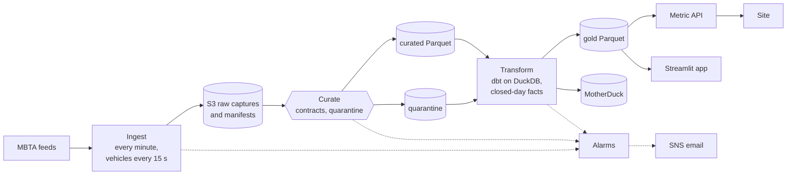

# Headway

**Can you trust a real-time transit metric? Every Headway number shows how much data stands behind it.**

Headway is a data platform for MBTA subway reliability, running continuously on AWS since 22 Nov 2026
([MEASUREMENTS](docs/MEASUREMENTS.md#reliability-of-ingest)). It keeps every raw capture, validates and curates
it, builds reliability metrics with dbt on DuckDB, and publishes each number with its coverage and freshness.

## Live

| | Link |
| --- | --- |
| Site | _to be added at go-live_ |
| API | _to be added at go-live_ |
| Streamlit app (Release 1) | https://headway-mbta.streamlit.app |

Neither the site nor the API is deployed yet ([Status](#status)).

## What it does

- **Captures every minute and keeps everything.** Trip updates and alerts once a minute, vehicle positions every 15 seconds, raw objects never modified, one manifest per minute ([ADR-014](docs/ARCHITECTURE_DECISIONS.md#adr-014-vehicle-positions-sampled-every-15-s)).
- **Validates before it counts.** Pydantic contracts at curation; rejected rows go to a quarantine with the reason; duplicate deliveries are flagged, never dropped ([lineage](docs/LINEAGE.md)).
- **Builds metrics with dbt on DuckDB.** Schedule deviation, prediction revision, reconstructed arrivals, headway adherence and more, defined in [METRICS](docs/METRICS.md); facts of closed days are computed once and reused ([ADR-024](docs/ARCHITECTURE_DECISIONS.md#adr-024-account-lambda-memory-cap)).
- **Shows its own health.** Coverage and freshness beside every number, and a data outage is kept apart from a disruption on the line ([Trust rules](#trust-rules)).
- **Serves the results.** Public gold Parquet, a read-only metric API and a Next.js site (built, not deployed), a Streamlit app, and a question-answering analyst limited to read-only tools over gold ([ADR-020](docs/ARCHITECTURE_DECISIONS.md#adr-020-analyst-data-access-through-the-public-gold-tables)).

## Architecture



More detail, with a stage table and the monitoring: [docs/architecture.md](docs/architecture.md).

## Measured results

Every figure links to the section that records its date and method.

| Measure | Result | Source |
| --- | --- | --- |
| Ingest completeness, 72 h | 0 of 4,321 minutes missed (0.00 %), checked 27 Nov | [MEASUREMENTS](docs/MEASUREMENTS.md#72-hour-window-release-1-acceptance-a2) |
| Ingest completeness, first 26 h | 1 of 1,562 expected runs missed (0.06 %); delay from scheduled minute to fetch median 17.6 s | [MEASUREMENTS](docs/MEASUREMENTS.md#reliability-of-ingest) |
| Volume | 4,320 captures a day at one poll a minute; about 2.0 million trip-update rows a day | [MEASUREMENTS](docs/MEASUREMENTS.md#volume) |
| Transform, first Lambda runs | timed out at 600 s, then 46 to 54 s per run | [MEASUREMENTS](docs/MEASUREMENTS.md#transform-runtime) |
| Transform with arrival facts on, production | 453 s (26 Nov), then 161 to 276 s over the next 26 runs (172 s on the first), one 402 s run during a rebuild; memory 62 to 65 % | [MEASUREMENTS](docs/MEASUREMENTS.md#production-runs-after-the-incremental-closed-day-facts-2026-11-26-2000-utc-to-2026-11-27-2025-utc) |
| Full rebuild against incremental, local | 182.8 s against 102.4 s (steady state), same output | [MEASUREMENTS](docs/MEASUREMENTS.md#full-rebuild-versus-incremental-closed-days) |
| S3 requests, manifest curation | 116,845 down to 143 in the benchmark (348 s down to 7.6 s) | [MEASUREMENTS](docs/MEASUREMENTS.md#transform-runtime) |
| Cost per 1,000 captures | $0.0199 on 26 Nov (day total $0.1022); an early, partial day, billed from Cost Explorer, S3 dominates | [MEASUREMENTS](docs/MEASUREMENTS.md#latency-and-cost) |
| Reconstructed arrivals against MBTA LAMP | 97.9 % of 165,684 rows matched; held-out days, bracketed stops: median absolute difference 15.8 s down to 7.0 s, within 30 s 82.5 % up to 90.3 % | [VALIDATION](docs/VALIDATION.md) |
| Invariant tests | found 2 bugs on production data (headway coverage above 100 %, a median above its own p95) | [DATA_QUALITY](docs/DATA_QUALITY.md#bugs-these-tests-found-on-production-data) |

The LAMP comparison is a cross-check against MBTA's own times from the same feed, not ground truth.
The dwell correction was fitted on 22 to 24 Nov only and scored on 25 and 26 Nov; 15-second data is
left uncorrected until it has enough days ([ADR-026](docs/ARCHITECTURE_DECISIONS.md#adr-026-dwell-correction-of-bracketed-arrivals-from-our-own-data)).
A hand check of 30 trip stops gave a median difference of 16.0 s ([MEASUREMENTS](docs/MEASUREMENTS.md#arrival-reconstruction)).

## Trust rules

- **Coverage.** No number is shown without its coverage (the share of observable scheduled trip stops, headways or trips with a usable observation) and its freshness ([METRICS](docs/METRICS.md)).
- **Withholding.** A value with coverage under 50 % is withheld everywhere, and lines are ranked only where coverage is comparable ([ADR-006](docs/ARCHITECTURE_DECISIONS.md#adr-006-data-outage-versus-transit-disruption)). Only high and medium confidence arrivals feed metrics ([ADR-016](docs/ARCHITECTURE_DECISIONS.md#adr-016-confidence-levels-only-high-and-medium-arrivals-feed-metrics)).
- **Outage versus disruption.** Metrics cover only hours the pipeline was observing; missed runs, failed fetches and quarantine are reported on their own, so a gap in the data is not read as a problem on the line.

These are Headway's approximations, not official MBTA metrics.

## Engineering highlights

Decisions ([all of them](docs/ARCHITECTURE_DECISIONS.md)):

- [ADR-001](docs/ARCHITECTURE_DECISIONS.md#adr-001-lambda--eventbridge-instead-of-kafka): scheduled Lambdas instead of Kafka.
- [ADR-006](docs/ARCHITECTURE_DECISIONS.md#adr-006-data-outage-versus-transit-disruption): a data outage is not a transit disruption.
- [ADR-012](docs/ARCHITECTURE_DECISIONS.md#adr-012-dbt-compute-in-lambda-duckdb-motherduck-gold-only-duckdb-156-pin): dbt in Lambda on DuckDB; MotherDuck stores only gold.
- [ADR-013](docs/ARCHITECTURE_DECISIONS.md#adr-013-duplicate-deliveries-are-flagged-never-dropped): duplicate deliveries are flagged, never dropped.
- [ADR-015](docs/ARCHITECTURE_DECISIONS.md#adr-015-immutable-history-of-daily-aggregates-versioned-per-metric-family): immutable daily history, versioned per metric family.
- [ADR-024](docs/ARCHITECTURE_DECISIONS.md#adr-024-account-lambda-memory-cap): work bounded to a fixed memory budget.
- [ADR-026](docs/ARCHITECTURE_DECISIONS.md#adr-026-dwell-correction-of-bracketed-arrivals-from-our-own-data): a bias found against LAMP, corrected from our own data, scored on held-out days.

Incidents (all of them in [INCIDENTS](docs/INCIDENTS.md), each with root cause, fix and guard):

- [Duplicate deliveries](docs/INCIDENTS.md#duplicate-deliveries): at-least-once scheduling delivered one minute four times; fixed with a conditional manifest write.
- [Transform scaling over S3 views](docs/INCIDENTS.md#transform-scaling-over-s3-views-and-overlapping-runs): 116,845 requests per benchmark down to 143, plus a run lock.
- [Transform duration at half the Lambda limit](docs/INCIDENTS.md#transform-duration-at-half-the-lambda-limit-caught-by-monitoring): a near miss found in the logs, fixed with persisted closed-day facts and a duration alarm.

Operations: alarms to an SNS topic, a [RUNBOOK](docs/RUNBOOK.md) entry per alarm, six replay simulations in `tests/simulations/` and two live failure drills.

## Status

As of 27 Nov 2026.

| Release | Status | Source |
| --- | --- | --- |
| 1: capture, curate, four metrics, Streamlit app, pipeline health | Signed off 26 Nov 2026: `make acceptance` 11 PASS, 0 FAIL, deploy walkthrough recorded | [DEPLOY](docs/DEPLOY.md#release-sign-offs) |
| 2: reconstructed arrivals, accuracy, headway adherence, immutable history, SLOs | Live, running continuously on AWS | [MEASUREMENTS](docs/MEASUREMENTS.md#transform-duration-with-closed-day-facts) |
| 3: forecasts, weather comparison, analyst | Built and tested; not switched on in AWS. Switch-on steps are in the deploy runbook. The forecast comparison waits for the 21-day training gate: no line has passed it | [ADR-019](docs/ARCHITECTURE_DECISIONS.md#adr-019-forecasting-design-target-horizons-leakage-rule-gate-baselines), [DEPLOY](docs/DEPLOY.md#release-3-switch-off-by-default) |
| 4: metric API and site | Built and tested; not deployed. Go-live checklist written | [API](docs/API.md), [web/README.md](web/README.md), [DEPLOY](docs/DEPLOY.md#release-4-switch-public-metric-api-off-by-default) |

Open items: the alert-versus-reality hand check and the alert classifier labels are pending
([MEASUREMENTS](docs/MEASUREMENTS.md#alert-vs-reality-hand-check)). Between 26 Nov 20:00 UTC and
27 Nov 21:25 UTC, `data_invariants_r2` failed in 7 of 27 transform runs: a countdown-coverage
definition bug, fixed in the repository and waiting for the next deploy
([MEASUREMENTS](docs/MEASUREMENTS.md#production-runs-after-the-incremental-closed-day-facts-2026-11-26-2000-utc-to-2026-11-27-2025-utc),
[DATA_QUALITY](docs/DATA_QUALITY.md#bugs-these-tests-found-on-production-data)).

## Quick start

```sh
make demo         # replay the bundled one-hour Boston sample, build the marts, start the app (no AWS account)
make check        # lint, types, unit tests
scripts/prepush.sh # make check and make e2e in a clean checkout, as CI runs them (see CONTRIBUTING.md)
make app-test     # Streamlit page and policy tests
make acceptance   # PASS / FAIL / MANUAL for the Release 1 acceptance tests (reads public data and read-only AWS)
make validate     # compare reconstructed arrivals with MBTA LAMP (see docs/VALIDATION.md)
make evals        # score the analyst on 40 questions (needs an API key; see docs/EVALS.md)
make api-dev      # run the metric API locally; make web-dev runs the site against it
```

Deploying a copy is described in [DEPLOY](docs/DEPLOY.md); failure handling in [RUNBOOK](docs/RUNBOOK.md).

## Repository map

| Path | Contents |
| --- | --- |
| `src/headway/` | ingest, parse, contracts, curate, export, CLI |
| `dbt/headway/` | dbt project: staging, intermediate, marts, tests |
| `dbt/headway_transform/` | transform Lambda: dbt run, gold export, publish, cost |
| `src/headway_api/` | read-only metric API (FastAPI on Lambda; [docs/API.md](docs/API.md)) |
| `src/headway_mcp/` | analyst: five read-only tools over public gold, budgets |
| `web/` | Next.js site over the metric API ([web/README.md](web/README.md)) |
| `app/` | Streamlit app |
| `ml/` | forecast training and evaluation |
| `infra/` | Terraform: `bootstrap/` (state bucket) and `main/` (stack) |
| `docker/` | container images for curate, transform, train and the API |
| `config/cities/` | city configuration (feeds, lines, timezone) |
| `samples/boston/` | one-hour sample with expected results |
| `scripts/`, `tests/`, `evals/` | benchmarks and reports; unit, replay and simulation tests; analyst evals |
| `docs/` | [architecture](docs/architecture.md), [metrics](docs/METRICS.md), [decisions](docs/ARCHITECTURE_DECISIONS.md), [lineage](docs/LINEAGE.md), [data quality](docs/DATA_QUALITY.md), [incidents](docs/INCIDENTS.md), [measurements](docs/MEASUREMENTS.md), [validation](docs/VALIDATION.md) |

Python 3.12, AWS Lambda, EventBridge Scheduler, S3, CloudWatch, Terraform, dbt Core with DuckDB,
Parquet, MotherDuck, FastAPI, Next.js, Streamlit.

## License

MIT, see [LICENSE](LICENSE). Transit data: MBTA; LAMP validation data provided by MassDOT and the MBTA,
not affiliated ([VALIDATION](docs/VALIDATION.md#source-and-licence)).
