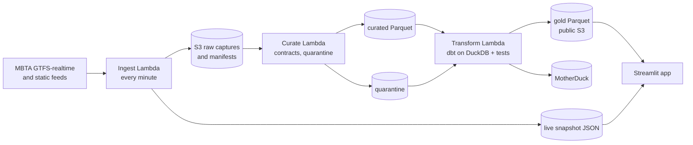

# Headway: Near-Real-Time Transit Reliability & AI Analytics

*Know the gap. Measure the reliability.*

Headway is a data platform for MBTA subway reliability. It captures the real-time and static
transit feeds every minute, keeps every raw capture, validates and curates them into Parquet with
a quarantine for bad rows, and builds reliability metrics with dbt on DuckDB. Every number is
published with its coverage and freshness, and the pipeline reports its own health so a gap in the
data is never mistaken for a disruption on the line. Cities are configured through YAML, so
nothing is tied to a single agency. The Streamlit app reads only public files over HTTPS.

**Live app:** https://headway-mbta.streamlit.app

**Measured:** transform 600 s timeout → about 46–54 s per run · $0.0086 per 1,000 captures ·
1 missed run in about 1,580 minutes. Method and dates in [docs/MEASUREMENTS.md](docs/MEASUREMENTS.md).

| Overview | Live map |
| --- | --- |
|  |  |
| **Line explorer** | **Pipeline health** |
|  |  |

<!-- TODO: docs/img is empty; add overview.png, live-map.png, line-explorer.png and
pipeline-health.png (captures of https://headway-mbta.streamlit.app). -->

## Architecture



Lineage with the validation, quarantine, alarm and replay points is in
[docs/LINEAGE.md](docs/LINEAGE.md).

## What it measures

Release 1 reports four metrics per subway line, defined in [docs/METRICS.md](docs/METRICS.md):

1. **Predicted schedule deviation:** predicted arrival minus scheduled arrival, from the last
   prediction before the scheduled time (median and p90).
2. **Prediction revision:** how much a prediction moves between snapshots.
3. **Coverage:** the share of observable scheduled trip stops with a usable observation.
4. **Freshness:** how old the data is when it arrives, and whether the pipeline kept up.

Rule: no number is shown without its coverage and freshness. Below 50% coverage values are
withheld, lines are ranked against each other only where coverage is comparable, and metrics are
reported only for hours the pipeline was observing. These are Headway approximations of
predictions, not official MBTA metrics.

## Key engineering decisions

The full set is in [docs/ARCHITECTURE_DECISIONS.md](docs/ARCHITECTURE_DECISIONS.md).

- [ADR-001](docs/ARCHITECTURE_DECISIONS.md#adr-001-lambda--eventbridge-instead-of-kafka): scheduled Lambdas instead of Kafka.
- [ADR-002](docs/ARCHITECTURE_DECISIONS.md#adr-002-parquet-on-s3-instead-of-iceberg): plain Parquet on S3 instead of Iceberg.
- [ADR-004](docs/ARCHITECTURE_DECISIONS.md#adr-004-event-time-feed-time-and-ingestion-time-kept-separate): event, feed and ingestion time kept separate.
- [ADR-005](docs/ARCHITECTURE_DECISIONS.md#adr-005-duplicates-and-out-of-order-events) and [ADR-013](docs/ARCHITECTURE_DECISIONS.md#adr-013-duplicate-deliveries-are-flagged-never-dropped): duplicates are flagged, never dropped.
- [ADR-006](docs/ARCHITECTURE_DECISIONS.md#adr-006-data-outage-versus-transit-disruption): a data outage is not a transit disruption.
- [ADR-012](docs/ARCHITECTURE_DECISIONS.md#adr-012-dbt-compute-in-lambda-duckdb-motherduck-gold-only-duckdb-156-pin): dbt runs in Lambda on DuckDB; MotherDuck stores only gold.

## Production incidents

Twelve incidents found while bringing the pipeline up in AWS, each with root cause, fix and the
test that now guards it, are in [docs/INCIDENTS.md](docs/INCIDENTS.md). Examples: the scheduler
placeholder that was never substituted, asynchronous retries that duplicated runs, a DuckDB
version MotherDuck did not support, and at-least-once scheduling that delivered the same minute
twice. What to do when an alarm fires, and how to rehearse the failures (six replay
simulations in `tests/simulations/`, two live drills through a chaos switch), is in
[docs/RUNBOOK.md](docs/RUNBOOK.md).

## Measured numbers

[docs/MEASUREMENTS.md](docs/MEASUREMENTS.md) records runtimes (transform 54 s per run, down from a
timeout), volumes (about 4,300 captures and 2 million prediction rows a day), ingest reliability
(0.06 % missed runs in the first 26 hours) and cost per 1,000 captures, each with date and method.

## Tech stack

Python 3.12 · AWS Lambda (arm64, zip and container images), EventBridge Scheduler, S3, CloudWatch,
SSM · Terraform · dbt Core with DuckDB 1.5.6 · Parquet and PyArrow · Pydantic contracts ·
MotherDuck · Streamlit, Plotly, pydeck · uv, ruff, mypy, pytest · GitHub Actions.

## Quick start

```sh
make demo
```

Replays the bundled one-hour Boston sample, builds the dbt marts, exports the gold tables and a
live snapshot to `.local/demo`, and starts the app at http://localhost:8501. It needs only `uv`
(and the dbt environment it installs); no AWS account.

```sh
make check        # lint, types, unit tests
make e2e          # replay the sample and compare the key tables
make app-test     # Streamlit page and policy tests
make acceptance   # PASS / FAIL / MANUAL for the Release 1 acceptance tests
```

The app reads its data from `HEADWAY_DATA_URL` (environment, then Streamlit secret), falling back
to the public gold bucket. Deploying your own copy is described in [docs/DEPLOY.md](docs/DEPLOY.md).

## Repository map

| Path | Contents |
| --- | --- |
| `src/headway/` | ingest, parse, contracts, curate, export, CLI |
| `dbt/headway/` | dbt project: staging, intermediate, marts, tests |
| `dbt/headway_transform/` | transform Lambda: dbt run, gold export, publish, cost |
| `src/headway_mcp/` | AI analyst: five read-only MCP tools over public gold, orchestration, budgets |
| `src/headway_api/` | public read-only metric API (FastAPI on Lambda, R4; [docs/API.md](docs/API.md), ADR-023) |
| `app/` | Streamlit app (`Home.py` navigation, `overview_page.py`, `pages/`, `lib/`, tests) |
| `web/` | public Next.js site (design system v2) over the metric API (not deployed; [web/README.md](web/README.md): `make api-dev`, `make web-dev`) |
| `infra/` | Terraform: `bootstrap/` (state bucket) and `main/` (stack) |
| `docker/` | container images for curate, transform, train and the API |
| `config/cities/` | city configuration (feeds, lines, timezone) |
| `samples/boston/` | one-hour sample with expected results |
| `scripts/` | demo build, e2e, acceptance report, benchmarks |
| `docs/` | metrics, decisions, lineage, deploy, incidents, measurements |

## AI analyst

The AI analyst page answers questions through five read-only tools that query only the public
gold Parquet (ADR-020). Every answer is checked against the tool results (numbers, causes,
direction words; ADR-008) and shows its SQL, definition, comparison period, coverage and freshness.
Without an OpenAI key, or over the cost limits (ADR-021), it shows precomputed examples.

### Evals

`make evals` scores the analyst on 40 questions (metric lookups, comparisons, dates, insufficient
data, causal traps, service versus data outage, metrics not computed, out of scope and injection)
against gold answers computed by SQL from a frozen snapshot of the demo data
(`evals/snapshot/`, small Parquet). It needs `OPENAI_API_KEY`, prints the cost and stops at
`--max-cost` (default $0.50), and exits non-zero unless numeric correctness is at least 90%,
unsupported claims at most 2%, refusals are 100% correct on insufficient data and injection, and
p90 latency is at most 10 s. The report is [docs/EVALS.md](docs/EVALS.md), regenerated by each
real run. `make evals EVALS_ARGS=--fake` runs a scripted model instead (the scorer's own test in
`make check`, no network).

### Alert classifier pilot and weather comparison

A pilot classifier sorts alert headers into six classes (`make alert-classifier`, labelling guide
in `evals/ALERT_LABELLING.md`, report [docs/ALERT_CLASSIFIER.md](docs/ALERT_CLASSIFIER.md) once the
labels are in); nothing in production depends on it. With R3 on, the Forecast page also compares
on-time and headway shares on snow, heavy-rain and extreme-heat days with other days, descriptively
and never causally ([docs/METRICS.md](docs/METRICS.md), weather source in ADR-022).

## Roadmap

- **Release 1 (this):** capture, curate, four metrics, public Streamlit app, pipeline health.
- **Release 2:** reconstructed arrivals with accuracy, actual deviation, headway adherence and ETT
  (exact 24 h and 7 d windows), immutable history beyond the 7-day rebuild window, persisted run
  state and service level objectives (`docs/SLO.md`); more cities from config.
- **Release 3:** natural-language analytics with unsupported claims prevented
  (ADR-008) and an MCP server (ADR-011).
- **Release 4:** a public read-only metric API (built, not deployed: [docs/API.md](docs/API.md),
  ADR-023), then a Next.js front end (ADR-010).

## License

MIT, see [LICENSE](LICENSE).
