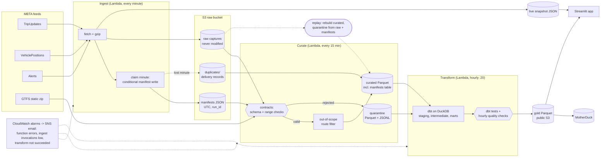
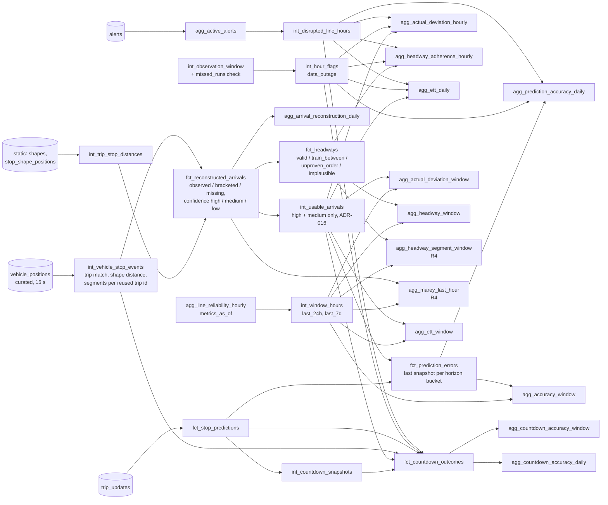
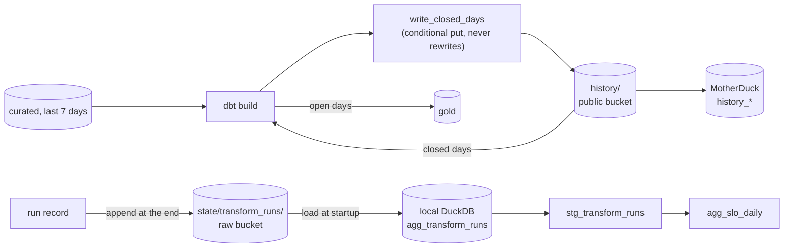
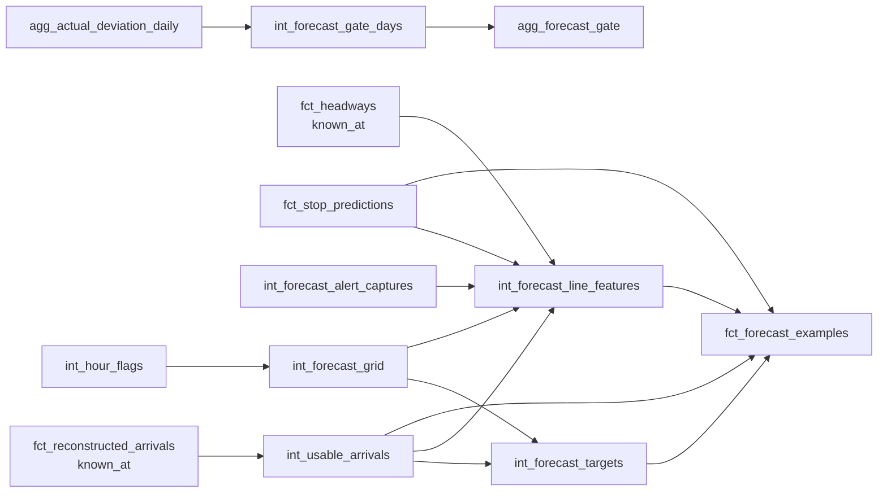
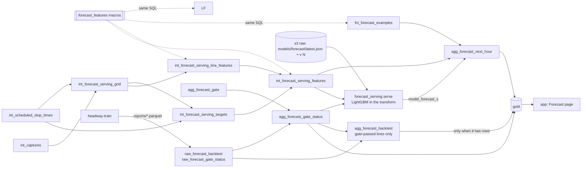
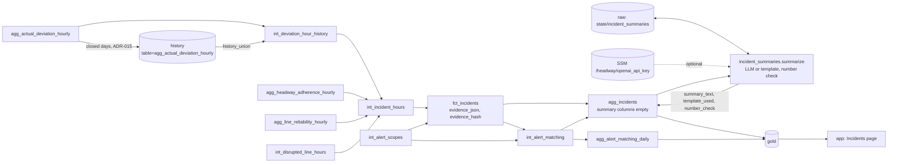
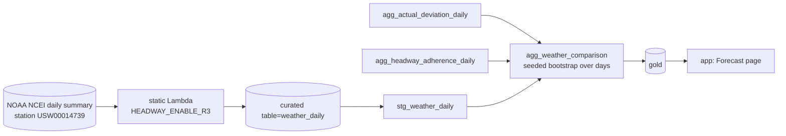

# Lineage

Written during Release 1.

## End to end

Where each control sits:

| Control | Where | What it does |
| --- | --- | --- |
| Validation | curate (`contracts`), dbt tests | Pydantic contracts reject rows with a bad schema, ids, coordinates or timestamps. dbt tests check grain, keys, accepted ranges and descriptions. |
| Quarantine | curate | Rejected rows are written with `capture_id`, `reason` and the original row, then counted in `agg_pipeline_health` and the hourly checks. Out-of-scope routes are filtered and counted, not quarantined. |
| Duplicate handling | ingest, curate, dbt | Lost-minute deliveries are recorded under `manifests/<city>/duplicates/` and flagged `duplicate_delivery`, never dropped (ADR-013). Identical payloads are flagged `is_duplicate_capture` (ADR-005). |
| Monitoring and alarms | CloudWatch, `agg_quality_checks_hourly` | Alarms on errors of every function, on too few ingest invocations and on a transform that did not succeed; hourly quality checks and the Pipeline health page show coverage, missed runs and quarantine. |
| Replay | `headway replay`, `backfill_manifests` | Raw captures and manifests are never modified, so curated, quarantine and manifest tables can be rebuilt deterministically (batch ids are content hashes). |

## Raw to curated to quarantine

Every object lives under a city prefix (`boston` below). Keys are UTC.

| Layer | Key | Written by |
| --- | --- | --- |
| raw | `raw/{prefix}/feed={feed}/dt=YYYY-MM-DD/hour=HH/{capture_id}.pb.gz` | ingest |
| manifest | `manifests/{prefix}/dt=YYYY-MM-DD/hour=HH/{run_id}.json` | ingest |
| curated | `curated/{prefix}/table={table}/dt=YYYY-MM-DD/hour=HH/part-{batch_id}.parquet` | `normalize_batch` |
| compacted | `curated/{prefix}/table={table}/dt=YYYY-MM-DD/hour=HH/part-compacted.parquet` | `compact_hour` |
| static | `curated/{prefix}/static/table={table}/feed_version={v}/part.parquet` | `load_static` |
| quarantine | `quarantine/{prefix}/table={table}/dt=YYYY-MM-DD/{capture_id}.jsonl` | `normalize_batch` |
| raw static | `raw/{prefix}/feed=gtfs_static/dt=YYYY-MM-DD/hour=HH/gtfs-{timestamp}.zip` | static Lambda |
| watermark | `state/{prefix}/curate_watermark.json` | `curate_new` |

- **Raw is never modified or deleted.** Curation only reads it, so any curated or quarantine
  object can be rebuilt by replaying raw and manifests (`headway replay`).
- **Curated** rows are partitioned by the capture's `fetched_at`. Realtime tables
  (`trip_updates`, `vehicle_positions`, `alerts`) carry `capture_id`, `run_id`, `city_id`,
  `content_hash`, `fetched_at` and `feed_header_ts`. Captures are never deduplicated; captures
  with identical content but different `capture_id` all appear, and `content_hash` lets
  downstream models flag them. The same `capture_id` in one batch is written once.
- **Quarantine** holds one JSON line per rejected row with `capture_id`, `reason`, `error` and the
  original row. Reasons: `schema_error`, `missing_trip_id`, `missing_stop_id`,
  `invalid_coordinates`, `timestamp_out_of_range`, `unknown_route` (`route_id` absent from the
  current GTFS routes) and `protobuf_parse_error` (one line for the whole capture; its raw object
  stays in place).
- **Scope filter.** Raw captures cover every mode. Rows whose route exists in GTFS but whose
  `route_type` is not in the city's `route_types` are dropped, not quarantined, and counted per
  table as `filtered_out_of_scope`. Rows without a `route_id` (stop-only or agency-wide alerts)
  are kept.
- **Batches** are the manifest entries of one fetched-at hour. `batch_id` is the first 16 hex
  characters of the SHA-256 of the sorted `capture_id`s, so reprocessing the same captures
  overwrites the same part file.
- **Watermark** records the latest `fetched_at` processed and the `capture_id`s seen at that
  instant. It moves only after all writes of a batch succeeded; a failed run is simply retried.
- **Compaction** merges an hour's `part-*.parquet` into `part-compacted.parquet`, deleting the
  inputs only after the merged row count equals the sum of the inputs. Re-running it is a no-op.
- **Static** tables are loaded once per `feed_version` (path-safe form in the key, raw value in
  the `feed_version` column); an existing version is skipped.

## Curated to gold (AWS)

| Step | Function | Schedule (UTC) | Reads | Writes |
| --- | --- | --- | --- | --- |
| curate | `headway-curate` | every 15 minutes | manifests, raw | curated, quarantine, state |
| compact | `headway-curate` with `{"task":"compact"}` | `:05` hourly | previous hour's parts | `part-compacted.parquet` |
| static | `headway-static` | daily 09:00 | `MBTA_GTFS.zip` | raw static, curated static |
| transform | `headway-transform` | `:20` hourly | curated, manifests, quarantine (last `lookback_days`) | gold, MotherDuck |

- **Gold** lives at `s3://headway-public-<account>/public/{prefix}/gold/` as the dbt allowlist
  tables, `manifest.json` (row counts, `dbt_run_at`, `metrics_as_of`) and `cost_daily.parquet`.
  The Streamlit app reads them through `HEADWAY_DATA_URL`.
- **Lookback.** Staging models of realtime sources (`trip_updates`, `vehicle_positions`,
  `alerts`, manifests, quarantine) keep rows whose `dt` partition is within `lookback_days` of
  today (UTC). Static GTFS tables are not filtered. Local and replay builds leave the variable
  unset and read everything.
- **`cost_daily`** is written by the transform Lambda once per UTC day (first run at or after
  06:00): one row per day and AWS service for resources tagged `project=headway`, with the day
  total, capture count from `agg_pipeline_health`, and `cost_per_1000_captures`. It is not a dbt
  model; the app treats a missing file as "no cost data yet".
- **MotherDuck** holds a copy of each gold table (and `cost_daily`), replaced on every run.

## Release 2: reconstruction, metrics and windows

All models below are tagged `r2`; the transform Lambda builds them only when
`HEADWAY_ENABLE_R2=true`. Rows of `vehicle_positions` are sampled every 15 s (ADR-014).

- **Reconstruction.** An arrival is the midpoint between the last observation before a vehicle's
  first `STOPPED_AT` at a stop and that observation (`observed`), or an interpolation along the
  shape between the observations either side (`bracketed`). Confidence is `high` for an interval
  up to 30 s, `medium` up to 120 s, otherwise `low`. A reused trip id starts a new `segment`.
  `int_usable_arrivals` keeps high and medium only and marks the segment nearest the schedule
  (`is_nearest_segment`); every Release 2 metric reads that model, never the low arrivals.
- **Outage and disruption flags.** `int_hour_flags.data_outage` marks hours with three or more
  missed runs or an incomplete vehicle window: metrics leave them out and count them
  (`n_excluded_outage`). `int_disrupted_line_hours` marks line hours with an active detour,
  suspension or shuttle alert: those hours stay in the statistics and are counted
  (`service_disruption`, `n_disruption`).
- **Windows.** `int_window_hours` lists the service hours of `last_24h` (24 hours) and `last_7d`
  (168 hours) ending at the latest hour of `agg_line_reliability_hourly` (the export's
  `metrics_as_of`). The four `agg_*_window` marts compute medians, p90 and shares over every
  eligible row of those hours, so the app never averages per-hour or per-day medians for a window.
  The daily and hourly marts remain for trends; the app labels any value built from them
  "approximate".
- **Gold.** The `gold_r2_allowlist` macro adds the six daily/hourly aggregates and the four window
  marts to the export when the flag is on; `publish.R2_GOLD_TABLES` publishes the same set to
  MotherDuck.

## Release 2: run state and history

Two kinds of object let the transform remember across runs, each in its own bucket and prefix.
Both are written by the transform Lambda; neither is touched by MotherDuck compute.

| Object | Key | Written | Read by |
| --- | --- | --- | --- |
| Run state | `s3://<raw>/state/transform_runs/dt=YYYY-MM-DD/rows.parquet` | end of every invocation: one row appended to the object of the UTC day | startup of the next run, which loads the last 35 days into `main.agg_transform_runs`; dbt reads it through `stg_transform_runs` |
| History | `s3://<public>/public/<city>/history/table=<agg>/metric_version=<N>/service_date=YYYY-MM-DD/part.parquet` | once, after the service day closes (06:00 local the next day), with a conditional put | dbt (`history_union`) for closed days; MotherDuck as `history_<agg>`; anyone, over HTTPS |

- **Run state is generic.** A `StateTable` (name, folder, columns, timestamp column, retention) is
  all a table needs to persist; the Elementary result tables will declare theirs.
  `agg_transform_runs` has one row per invocation: run id, task (`scheduled` or `rebuild_history`),
  the scheduled hour it belongs to (`slot`: start minus 20 minutes, floored to the hour), start and
  end, status (`success`, `tests_failed`, `failed`), test counts, rows exported, when gold was
  exported, whether MotherDuck was published, duration and steps. A run records itself last, so it
  appears in the table one run later. A run skipped by the lock records nothing.
- **History is append-only.** Days are never rewritten; a change of definition bumps the metric
  version of its family and backfills with `{"task":"rebuild_history",...}` (ADR-015).
  `metric_version` is the single constant per family in `headway_transform/history.py`.

- **SLOs.** `agg_slo_daily` reads capture minutes (`int_captures`), the persisted runs
  (`stg_transform_runs`) and the hourly actual-deviation coverage, and its closed days are kept
  in history; `agg_slo_rollup` sums them over 7 and 30 service dates. `make slo-report` reads the
  published tables over HTTPS and writes `docs/SLO_REPORT.md` (definitions in `docs/SLO.md`).

## Release 3: forecast examples (internal)

Tagged `r3`; the transform Lambda builds them only with `HEADWAY_ENABLE_R3=true` (and R2). The
examples are not exported; the serving and report tables below are. `fct_reconstructed_arrivals` and `fct_headways` carry `known_at` (ADR-019).

`make backtest` (`ml/`, local only) reads `fct_forecast_examples` and `agg_forecast_gate` from the
built DuckDB and writes `agg_forecast_backtest` to `.local/backtest/backtest.duckdb` and a run to
MLflow; neither is a dbt model or exported.

With `enable_r3` the transform also writes each closed service day of `fct_forecast_examples` and
`int_forecast_gate_days` once to `s3://<raw>/state/forecast_examples/` and `.../forecast_gate_days/`
(`metric_version=1`, immutable Parquet). The weekly training job reads those partitions, recomputes
the gate from the gate days, and writes `models/forecast/v<N>/` and `latest.json` (ADR-019).

### Serving and reports (Phase 3.3)

The training job writes `models/forecast/reports/backtest.parquet` and `gate_status.parquet` on
every run. Before the build the transform loads them into the warehouse (empty when absent), after
the build it scores the next hour, then exports. `agg_forecast_backtest` is exported only when a
line has passed the gate.

### Incidents, summaries and alert matching (Phase 3.4)

`agg_incidents` leaves the dbt build with empty summary columns; the transform fills them after the
build (like the model forecast of `agg_forecast_next_hour`) and before the export. The summaries
persist in the raw bucket so a version is written once and the daily call cap holds across runs.

## Release 3: weather comparison

Tagged `r3`. The static Lambda writes the daily weather (ADR-022); the model compares days, never
causes.

