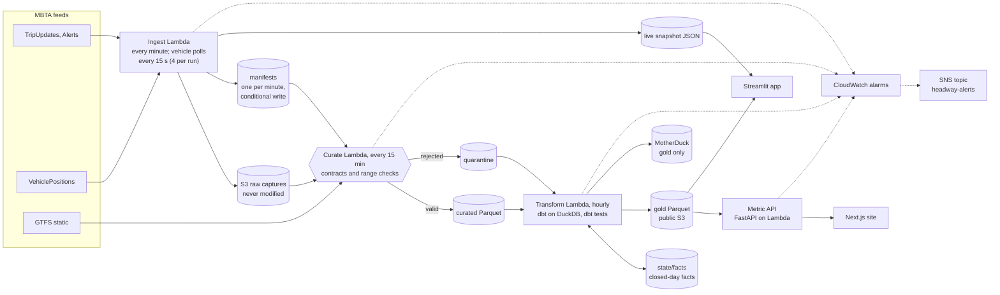

# Architecture

How a capture becomes a published number, and where the controls sit. The decisions behind each
step are in [ARCHITECTURE_DECISIONS](ARCHITECTURE_DECISIONS.md); the object layout, quarantine
reasons and replay are in [LINEAGE](LINEAGE.md).

## Stages

| Stage | What runs | Key behaviour | Decision |
| --- | --- | --- | --- |
| Ingest | Lambda, scheduled every minute | The first poll of a minute fetches all three realtime feeds; three more polls at +15, +30 and +45 s fetch vehicle positions only. A poll more than 5 s late is skipped and nothing starts after 55 s. One manifest per scheduled minute, claimed with a conditional create. | [ADR-001](ARCHITECTURE_DECISIONS.md#adr-001-lambda--eventbridge-instead-of-kafka), [ADR-014](ARCHITECTURE_DECISIONS.md#adr-014-vehicle-positions-sampled-every-15-s) |
| Raw and manifests | S3 | Every capture is kept as received, with UTC timestamps and run ids. Raw is never modified, so everything downstream can be rebuilt by replay. Duplicate deliveries of a minute are recorded and flagged, never dropped. | [ADR-013](ARCHITECTURE_DECISIONS.md#adr-013-duplicate-deliveries-are-flagged-never-dropped) |
| Curate | Lambda (container image), every 15 min | Pydantic contracts check schema, ids, coordinates and timestamps. Valid rows go to curated Parquet; rejected rows go to quarantine with the capture id, the reason and the original row. Out-of-scope routes are filtered and counted. | [ADR-004](ARCHITECTURE_DECISIONS.md#adr-004-event-time-feed-time-and-ingestion-time-kept-separate), [ADR-005](ARCHITECTURE_DECISIONS.md#adr-005-duplicates-and-out-of-order-events) |
| Transform | Lambda (container image), hourly | dbt on DuckDB builds staging, intermediate and mart models and runs the dbt tests, including the invariant tests in [DATA_QUALITY](DATA_QUALITY.md). Facts of closed service days are computed once and kept under `state/facts/`; each run builds only the open days. Memory is bounded to the account cap. A run takes an S3 lock, so overlapping runs do not double the load. | [ADR-012](ARCHITECTURE_DECISIONS.md#adr-012-dbt-compute-in-lambda-duckdb-motherduck-gold-only-duckdb-156-pin), [ADR-024](ARCHITECTURE_DECISIONS.md#adr-024-account-lambda-memory-cap) |
| Gold | Parquet on public S3 | The marts the transform exports, with a manifest of row counts. The Streamlit app and the API read gold; nothing in them calls the MBTA. | [ADR-020](ARCHITECTURE_DECISIONS.md#adr-020-analyst-data-access-through-the-public-gold-tables) |
| MotherDuck | Managed DuckDB | Stores gold only, published at the end of each transform run. The DuckDB version is pinned to what MotherDuck supports. | [ADR-012](ARCHITECTURE_DECISIONS.md#adr-012-dbt-compute-in-lambda-duckdb-motherduck-gold-only-duckdb-156-pin) |
| API | FastAPI on Lambda | Public read-only metric API over gold, with a typed response schema. Built and tested; see [API](API.md) for its deployment status. | [ADR-023](ARCHITECTURE_DECISIONS.md#adr-023-public-read-only-metric-api) |
| Site | Next.js | Reads the metric API. See [web/README.md](../web/README.md) for its deployment status. | [ADR-010](ARCHITECTURE_DECISIONS.md#adr-010-streamlit-first-then-nextjs--fastapi) |

## Monitoring

CloudWatch alarms notify the `headway-alerts` SNS topic by email. Each alarm has a section in the
[RUNBOOK](RUNBOOK.md#alarms) saying what it means and what to do. They cover errors of each
function, too few ingest invocations, a transform that did not succeed, transform duration and
memory, a failing error-severity data test, stale gold, missed minutes, low arrival coverage, API
5xx errors and the forecast training job. Failure rehearsals (six replay simulations in
`tests/simulations/` and two live drills through the chaos switch of
[ADR-017](ARCHITECTURE_DECISIONS.md#adr-017-chaos-switch-for-failure-drills)) are described in the
RUNBOOK.

## Data outage versus disruption

Aggregates cover only hours the pipeline was observing. A gap in a metric can mean the trains
stopped or that Headway stopped looking, and the two are kept apart
([ADR-006](ARCHITECTURE_DECISIONS.md#adr-006-data-outage-versus-transit-disruption)): missed runs,
failed fetches and quarantine are reported on their own, and hours without enough capture minutes
are labelled as outages and left out of the metrics.
